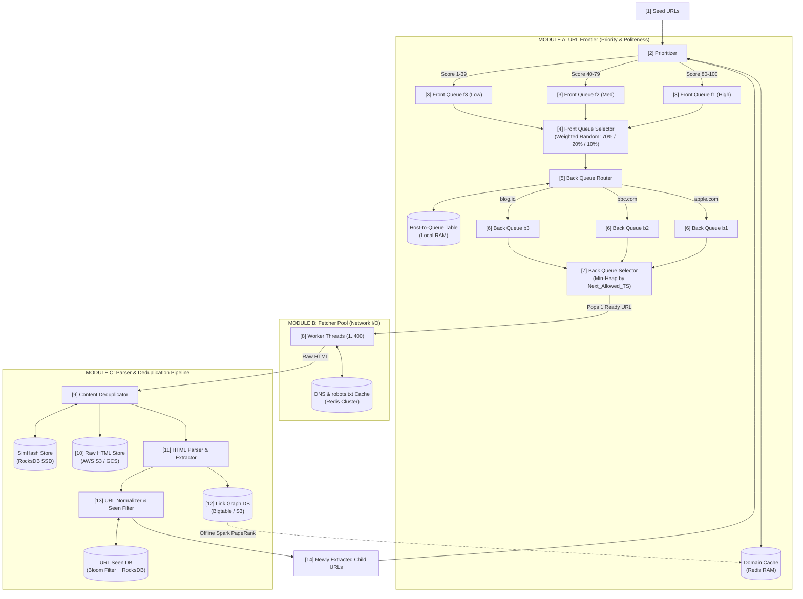

# Distributed Web Crawler: End-to-End Production Architecture

A complete system design guide covering **URL Prioritization (Front Queues)**, **Politeness & Rate Limiting (Back Queues)**, **Storage Engines**, **PageRank Scoring**, and **Spider-Trap Defenses**.

---

## 1. Core Design Philosophy

A production web crawler’s **URL Frontier** acts as an air traffic control system for web links, solving two conflicting constraints simultaneously:

1. **Priority (Business Value):** Crawl high-authority, frequently updated pages (e.g., breaking news on `apple.com/news`) before low-value, static pages (e.g., a 2014 thread on `randomforum.net`).
2. **Politeness (Rate Limiting):** Never overwhelm a target web server (e.g., hitting `apple.com` with 10,000 requests/sec and getting IP-banned). Enforce strict single-file queuing and cooldown delays per hostname.

---

## 2. Complete End-to-End Architecture Diagram

Follow steps **`[1]`** through **`[14]`** to trace the full lifecycle of a URL from initial discovery to child link extraction.

```text
  [1] SEED URLs (Initial Startup)               [14] NEWLY EXTRACTED CHILD URLs
         │                                                   │
         └─────────────────────────┬─────────────────────────┘
                                   ▼
   ╔════════════════════════════════════════════════════════════════════════╗
   ║ MODULE A: THE URL FRONTIER (Priority & Politeness Engine)              ║
   ║                                                                        ║
   ║               ┌───────────────────────────────┐      ┌───────────────┐ ║
   ║          [2]  │        PRIORITIZER            │◄────►│ Domain Cache  │ ║
   ║               │ (Scores URL from 1 to 100)    │      │ (Redis: RAM)  │ ║
   ║               └───────────────┬───────────────┘      └───────────────┘ ║
   ║                               │                                        ║
   ║       ┌───────────────────────┼───────────────────────┐                ║
   ║       ▼ (Score: 80-100)       ▼ (Score: 40-79)        ▼ (Score: 1-39)  ║
   ║ ┌───────────┐           ┌───────────┐           ┌───────────┐          ║
   ║ │ Front Q   │           │ Front Q   │           │ Front Q   │ [3]      ║
   ║ │ f1 (High) │           │ f2 (Med)  │           │ f3 (Low)  │ (Disk-   ║
   ║ │[apple/news│           │[apple/tos]│           │[forum/p99]│  backed  ║
   ║ │[bbc/home] │           │[blog/post]│           │           │  FIFOs)  ║
   ║ └─────┬─────┘           └─────┬─────┘           └─────┬─────┘          ║
   ║       └───────────────────────┼───────────────────────┘                ║
   ║                               ▼                                        ║
   ║               ┌───────────────────────────────┐                        ║
   ║          [4]  │     FRONT QUEUE SELECTOR      │                        ║
   ║               │ (Weighted Random: f1=70%, etc)│                        ║
   ║               └───────────────┬───────────────┘                        ║
   ║                               ▼                                        ║
   ║               ┌───────────────────────────────┐      ┌───────────────┐ ║
   ║          [5]  │       BACK QUEUE ROUTER       │◄────►│ Host-to-Queue │ ║
   ║               │  (Groups URLs by Hostname)    │      │ Table (RAM)   │ ║
   ║               └───────────────┬───────────────┘      └───────────────┘ ║
   ║                               │                                        ║
   ║       ┌───────────────────────┼───────────────────────┐                ║
   ║       ▼ (Host: apple.com)     ▼ (Host: bbc.com)       ▼ (Host: blog.io)║
   ║ ┌───────────┐           ┌───────────┐           ┌───────────┐          ║
   ║ │ Back Q b1 │           │ Back Q b2 │           │ Back Q b3 │ [6]      ║
   ║ │[apple/news│           │[bbc/home] │           │[blog/post]│ (1 Host  ║
   ║ │[apple/tos]│           │           │           │           │  per Q)  ║
   ║ └─────┬─────┘           └─────┬─────┘           └─────┬─────┘          ║
   ║       └───────────────────────┼───────────────────────┘                ║
   ║                               ▼                                        ║
   ║               ┌───────────────────────────────┐                        ║
   ║          [7]  │      BACK QUEUE SELECTOR      │                        ║
   ║               │  (Min-Heap sorted by Next_TS) │                        ║
   ║               │  Top: [b1 @ 12:00:01.000]     │                        ║
   ║               └───────────────┬───────────────┘                        ║
   ╚═══════════════════════════════╪════════════════════════════════════════╝
                                   │ Pops 1 URL when timestamp is reached
                                   ▼
   ╔════════════════════════════════════════════════════════════════════════╗
   ║ MODULE B: FETCHER / DOWNLOADER POOL (Network I/O)                      ║
   ║                                                                        ║
   ║               ┌───────────────────────────────┐      ┌───────────────┐ ║
   ║          [8]  │   WORKER THREADS (1 .. 400)   │◄────►│ DNS + Robots  │ ║
   ║               │  (HTTP Client fetches HTML)   │      │ Cache (Redis) │ ║
   ║               └───────────────┬───────────────┘      └───────────────┘ ║
   ╚═══════════════════════════════╪════════════════════════════════════════╝
                                   │ Raw HTML Bytes
                                   ▼
   ╔════════════════════════════════════════════════════════════════════════╗
   ║ MODULE C: PARSER & DEDUPLICATION PIPELINE (CPU & Storage)              ║
   ║                                                                        ║
   ║               ┌───────────────────────────────┐      ┌───────────────┐ ║
   ║          [9]  │    CONTENT DEDUPLICATOR       │◄────►│ SimHash Store │ ║
   ║               │ (Hashes HTML to spot clones)  │      │ (RocksDB/SSD) │ ║
   ║               └───────────────┬───────────────┘      └───────────────┘ ║
   ║                               ├──► [10] Save Raw HTML to S3 / Blob DB  ║
   ║                               ▼                                        ║
   ║               ┌───────────────────────────────┐      ┌───────────────┐ ║
   ║         [11]  │   HTML PARSER & EXTRACTOR     │─────►│ Link Graph DB │ ║
   ║               │ (Finds all <a href="...">)    │ [12] │ (Bigtable/S3) │ ║
   ║               └───────────────┬───────────────┘      └───────┬───────┘ ║
   ║                               ▼                              │         ║
   ║               ┌───────────────────────────────┐              │(Offline ║
   ║         [13]  │  URL NORMALIZER, FILTER &     │              │ Spark   ║
   ║               │  "URL SEEN?" DEDUPLICATOR     │              │ Job)    ║
   ║               └───────────────┬───────────────┘              ▼         ║
   ║                               │                      ┌───────────────┐ ║
   ║                               │                      │ URL Seen DB   │ ║
   ║                               │                      │ (Bloom Filter)│ ║
   ╚═══════════════════════════════╪══════════════════════┴───────────────┘ ║
                                   │                                        
                                   └──► Loops back to [14] (Top of Diagram!)
```

### Mermaid Architecture Flowchart (GitHub Native Rendering)



---

## 3. Visual Anatomy of the Queues ("Looking Inside Memory")

If we inspect the state of the queues at `12:00:00.000`, here is what the data structures hold:

### A. Inside the Front Queues ($f_1 \dots f_k$)
*Sorted strictly by **Business Priority**, mixing different domains together.*

```text
f1 (High Priority - 70% selection probability):
  HEAD ──► [ "[https://apple.com/news](https://apple.com/news)" ] ──► [ "[https://bbc.com/home](https://bbc.com/home)" ] ◄── TAIL

f2 (Med Priority  - 20% selection probability):
  HEAD ──► [ "[https://apple.com/tos](https://apple.com/tos)" ]  ──► [ "[https://blog.io/post](https://blog.io/post)" ] ◄── TAIL

f3 (Low Priority  - 10% selection probability):
  HEAD ──► [ "[https://forum.net/p99](https://forum.net/p99)" ] ◄── TAIL
```

### B. Inside the Host-to-Back-Queue Mapping Table
*Guarantees all URLs sharing a hostname are routed into a single dedicated Back Queue.*

| Hostname (Key) | Assigned Back Queue (Value) | Status |
| :--- | :--- | :--- |
| `apple.com` | `b1` | Active |
| `bbc.com` | `b2` | Active |
| `blog.io` | `b3` | Active |
| `forum.net` | *Unassigned* | Waiting for an empty Back Queue |

### C. Inside the Back Queues ($b_1 \dots b_n$) & The Min-Heap
*Isolated strictly by **Hostname** (1 Host = 1 Queue). Notice how `apple.com/news` (from $f_1$) sits ahead of `apple.com/tos` (from $f_2$) inside Queue `b1`!*

```text
Back Queue b1 (apple.com ONLY):
  HEAD ──► [ "[https://apple.com/news](https://apple.com/news)" ] ──► [ "[https://apple.com/tos](https://apple.com/tos)" ] ◄── TAIL

Back Queue b2 (bbc.com ONLY):
  HEAD ──► [ "[https://bbc.com/home](https://bbc.com/home)" ] ◄── TAIL

Back Queue b3 (blog.io ONLY):
  HEAD ──► [ "[https://blog.io/post](https://blog.io/post)" ] ◄── TAIL

MIN-HEAP (Back Queue Selector ordered by Next Allowed Crawl Timestamp):
            [ Root: (TS: 12:00:01.000, Queue: b1) ]
                   /                       \
  (TS: 12:00:01.200, Queue: b2)   (TS: 12:00:02.500, Queue: b3)
```

---

## 4. Step-by-Step Component Walkthrough (`[1]` to `[14]`)

### Module A: The URL Frontier (Priority & Politeness)
* **`[1]` Seed URLs:** The initial entry points (e.g., `wikipedia.org`, `apple.com`) used to bootstrap the crawler on Day 1.
* **`[2]` Prioritizer + Domain Cache (Redis):** Scores incoming URLs (`1` to `100`) *before* the page is downloaded. It queries the in-memory **Domain Cache** for domain authority, historical update frequency ($\lambda$), and evaluates URL path depth (`/news` scores higher than `/a/b/c?page=42`).
* **`[3]` Front Queues ($f_1 \dots f_k$):** Disk-backed FIFO queues representing priority tiers. Typically **8 to 32 queues** total, regardless of QPS.
* **`[4]` Front Queue Selector:** Uses biased random selection (e.g., $f_1 = 70\%$, $f_2 = 20\%$, $f_3 = 10\%$). Ensures high-priority URLs move quickly without permanently starving low-priority queues.
* **`[5]` Back Queue Router + Mapping Table:** Extracts the hostname from the selected URL and checks the **Host-to-Queue Table**.
  * If `apple.com` maps to `b1`, the URL is appended to `b1`.
  * If a Back Queue drains completely empty, its hostname mapping is deleted and the Router refills it from the Front Queues until a new unassigned domain is found.
* **`[6]` Back Queues ($b_1 \dots b_n$):** In-memory FIFO queues where **each queue holds URLs for strictly one domain**.
* **`[7]` Back Queue Selector (Min-Heap):** Tracks the earliest millisecond each Back Queue is allowed to be crawled next.
  1. A free Worker pops the root of the Min-Heap (`b1`).
  2. `b1` is temporarily **locked/checked out** so no other worker can touch `apple.com` concurrently.
  3. Once the HTTP download finishes, the worker re-inserts `b1` into the Min-Heap with `Next_TS = Current_Time + Politeness_Delay`.

### Module B: Fetcher / Downloader Pool (Network I/O)
* **`[8]` Worker Threads + DNS & `robots.txt` Cache:**
  * **`robots.txt` Cache:** Checks cached rules for disallowed paths and `Crawl-delay` directives before making a request.
  * **Local DNS Cache:** Resolves domain names to IP addresses in $<1\text{ ms}$ to avoid external DNS bottlenecks.

### Module C: Parser & Deduplication Pipeline
* **`[9]` Content Deduplicator (`SimHash`):** Generates a 64-bit fingerprint of the page's text and checks **RocksDB**. Since ~30% of the web is duplicate content, matching fingerprints are dropped immediately. Unique pages update the domain's change frequency ($\lambda$) metric.
* **`[10]` Raw HTML Blob Store:** Saves compressed HTML to distributed object storage (**AWS S3 / GCS**) for downstream search indexing.
* **`[11]` HTML Parser & Extractor:** Parses the DOM tree and extracts all outbound `<a href="...">` links and anchor text.
* **`[12]` Link Graph DB + Offline Spark Job:** Appends `(Source_Domain -> Target_Domain)` edges to storage. An offline batch job runs PageRank daily and updates the **Domain Cache** in step `[2]`.
* **`[13]` URL Normalizer, Filter & "URL Seen?" Check:**
  * Canonicalizes URLs (strips ports, sorts query params, resolves relative paths).
  * Filters out binary extensions (`.jpg`, `.mp4`, `.zip`).
  * Checks the **Bloom Filter + RocksDB** to verify if the URL was already crawled. If unseen, it passes to `[14]`.
* **`[14]` Loop Closure:** Unseen child URLs enter the **Prioritizer** `[2]` to continue the crawl cycle.

---

## 5. Deep Dive: How the Prioritizer Works & Defeats Loops

### Offline Scoring Pipeline vs. Online Fast Path
The Prioritizer never computes PageRank on the fly. It relies on an **Offline Batch Pipeline** that populates an **Online Redis Cache**:

```text
[ OFFLINE PIPELINE (Daily Spark Job) ]
  ┌──────────────────────────────────┐   ┌──────────────────────────────────┐
  │ 1. Link Graph Store (Bigtable/S3)│   │ 2. Real-World Traffic Feeds      │
  │ • Deduplicated Set of Edges      │   │ • Cloudflare DNS / CrUX / Tranco │
  └────────────────┬─────────────────┘   └─────────────────┬────────────────┘
                   └───────────────────┬───────────────────┘
                                       ▼
                         ┌───────────────────────────┐
                         │  Spark PageRank Engine    │
                         └─────────────┬─────────────┘
                                       │ Writes compact Key-Value scores
                                       ▼
[ ONLINE FAST PATH (<1ms Lookup) ]
                         ┌───────────────────────────┐
                         │   Domain Metadata Cache   │
                         │     (Redis / RocksDB)     │
                         │  "apple.com" -> Score: 99 │
                         │  "forum.net" -> Score: 12 │
                         └───────────────────────────┘
```

### Domain-Level PageRank Formula
$$PR(A) = \frac{1 - d}{N} + d \sum_{i=1}^{k} \frac{PR(T_i)}{C(T_i)}$$

* $PR(T_i)$: Authority score of linking domain $T_i$.
* $C(T_i)$: Total outbound domain links from $T_i$.
* $d$: Damping factor ($0.85$), taxing 15% of authority on every hop.

### "Apple Product" vs. "Apple Fruit": How Does It Know?
* **General Web Crawler (Googlebot):** The Prioritizer **does not care** about topic—it only prioritizes authority and freshness. Entity disambiguation (*iPhone* vs. *Orchard*) happens later in the Search Indexer after downloading the HTML.
* **Focused/Topical Crawler:** Runs a lightweight text classifier (e.g., FastText) on the **Parent Page's Anchor Text** and URL tokens *before* downloading the target URL.

### 4 Defenses Against Spider Traps & Infinite Loops
1. **Ignore Self-Links:** Internal links (`apple.com/a -> apple.com/b`) are discarded during domain-level PageRank calculation (`Weight = 0`). A domain cannot vote for itself.
2. **Edge Deduplication (Set Storage):** 50,000 links from `siteA.com` to `siteB.com` are collapsed into a single unique edge `(siteA.com -> siteB.com)` in the Link Graph DB.
3. **URL Seen Filter (Bloom Filter):** Stops the crawler from re-enqueueing `Page 1 -> Page 2 -> Page 1` loops at step `[13]`.
4. **PageRank Damping Factor ($d = 0.85$):** Drains 15% of score on every hop in a 2-site link ring (`ring1.com <-> ring2.com`), ensuring isolated spam rings converge to near-zero authority.

---

## 6. Capacity Planning: Queue Sizing & Worker Math

### Why Front Queue Count ($K$) is Independent of QPS
Front Queues ($f_1 \dots f_k$) represent **priority buckets** (like shipping classes: *Overnight, 2-Day, Ground*). Whether crawling at 100 QPS or 100,000 QPS, **8 to 32 Front Queues** provide sufficient priority granularity.

### Why Back Queues ($B$) Must Be $\ge 3\times$ Worker Count ($W$)
Maximum polite throughput is bounded by the number of active domains in Back Queues divided by the average politeness delay:

$$\text{Max Polite QPS} = \frac{\text{Number of Back Queues }(B)}{\text{Average Politeness Delay }(T_{\text{delay}})}$$

#### Scenario 1: $1:1$ Ratio ($400\text{ Workers} = 400\text{ Back Queues}$, $2.0\text{s}$ Delay) — **Starvation!**
```text
[12:00:00.000] 400 Workers pop 1 URL each from b1..b400. (Min-Heap is now EMPTY)
[12:00:00.200] All 400 HTTP downloads finish (200ms latency).
               b1..b400 are pushed back to Min-Heap with Next_TS = 12:00:02.200.
[12:00:00.201] Workers ask Min-Heap for work -> ALL QUEUES ON COOLDOWN!
               ⚠️ All 400 Workers sit 100% IDLE for 2.0 full seconds!
```

#### Scenario 2: $3:1$ Mercator Ratio ($400\text{ Workers}, 1,200\text{ Back Queues}$, $2.0\text{s}$ Delay) — **100% Utilization!**
```text
[12:00:00.000] 400 Workers pop b1..b400. (b401..b1200 remain ready in Min-Heap)
[12:00:00.200] Workers finish b1..b400 (cooldown until 12:00:02.200) -> Immediately pop b401..b800!
[12:00:00.400] Workers finish b401..b800 (cooldown until 12:00:02.400) -> Immediately pop b801..b1200!
```
* **Politeness is 100% preserved:** `b1` (`apple.com`) is locked during download and cannot be touched again until its `12:00:02.200` timer expires.
* **Workers never stall:** While `b1..b400` cool down in the Min-Heap, workers stay busy processing `b401..b1200`.

---

## 7. Master Storage Cheat Sheet

| Component / Dataset | Storage Engine Used | Architectural Justification |
| :--- | :--- | :--- |
| **Front Queues ($f_1 \dots f_k$)** | **RocksDB** or **Apache Kafka** (SSD + RAM buffer) | Holds **billions** of waiting URLs (hundreds of GBs). Pure RAM would `OOM`; disk-backed append logs prevent data loss. |
| **Host-to-Back-Queue Table** | **In-Memory Hash Map** (Local Process RAM) | Tracks only active Back Queues (e.g., 1,200 domains). Tiny footprint ($<1\text{ MB}$) requiring nanosecond lookups. |
| **Back Queues ($b_1 \dots b_n$) & Min-Heap** | **Local Process RAM** + **RocksDB WAL** | Workers pop/push hundreds of times per second. Requires lock-optimized in-memory structures with a Write-Ahead Log for crash recovery. |
| **Domain Priority Cache** | **Redis** or **Local RocksDB** | $100\text{M domains} \times 16\text{ bytes} \approx 1.6\text{ GB}$. Fits entirely in RAM for $<1\text{ ms}$ lookups by the Prioritizer. |
| **DNS & `robots.txt` Cache** | **Redis Cluster** (with 24h TTL) | Shared across all worker nodes so a `robots.txt` fetched by Worker 1 is immediately cached for Worker 2. |
| **Content Seen (`SimHash`)** | **RocksDB / Cassandra** (SSD Key-Value) | Billions of 64-bit fingerprints. SSD-backed LSM-trees provide fast reads without expensive multi-terabyte RAM clusters. |
| **URL Seen Filter** | **In-Memory Bloom Filter** + **RocksDB** | A Bloom Filter in RAM rejects 99% of unseen URLs instantly using ~1.2 GB per billion URLs; RocksDB verifies the remaining 1%. |
| **Raw HTML Pages** | **AWS S3 / GCS / HDFS** (Blob Store) | HTML payloads average 50–200 KB. Object storage is the most cost-effective tier for petabytes of raw documents. |
| **Link Graph (`Src -> Dst`)** | **S3 Parquet / Google Bigtable** | Consumed sequentially by daily offline Spark PageRank jobs; columnar/batch storage optimizes scan throughput. |